# Quick Recall

<strong>Data Analyst</strong> · 23 palaces · 85 atoms

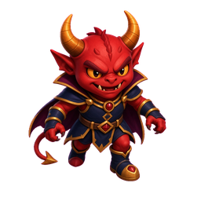 [De] devil [I use a (blueprint) to (lightning bolt)] [proprietary Python (gears)] [uniformly across the (grapes)] [for highly specialized (butterfly).] — Note: This strictly demands explicitly importing and defining the exact target return type from the internal SQL types module.
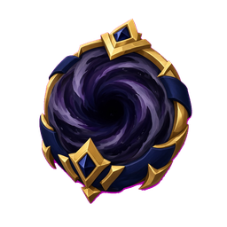 [Dd] Dark dragon [I use the (fence) to (glass divider)] [the tabular (ledger)] [based on categorical (ruler)] [to establish distinct (chalk line).] — Note: The aggregated results can then be systematically reorganized utilizing the orderBy method.

 [Dc] Dark cat [I use the (blender) to (potion)] [complex summary (abacus)] [across millions of (oars)] [using a mapped (book).] — Note: The keys map to target column names and the values represent string-based instructions for mathematical functions.
 [Db] Dark bird of paradise [I use the (stop sign) to (handcuffs)] [the distributed (grid)] [to (vinyl record) satisfying] [strict analytical (thermometer).] — Note: This method operates as an exact syntactic alias for the filter method.
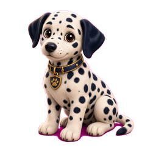 [Da] dalmatian [I use the (tweezers) to (quarantine tent)] [specific target (dials)] [from a complex (grid)] [to minimize memory (umbrella)] [for analytical (scalpel).] — Note: Passing a single asterisk fetches every available column simultaneously.
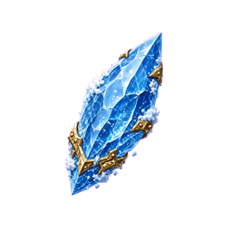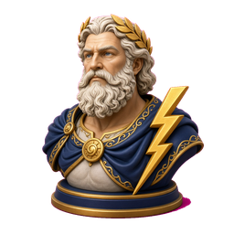 [Cz] Cold Zeus [I use the (magnifying glass) to (megaphone)] [the underlying (engine block)] [to sample the (box)] [and intelligently (clipboard)] [appropriate structured (blocks).] — Note: This prevents all columns from defaulting to generic string data types.
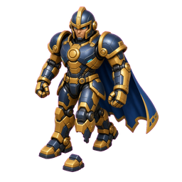 [Cy] cyborg [I use the (book) to (wand)] [a distributed (grid)] [from a remote (folder)] [by explicitly (stamp)] [the architectural (hat).] — Note: This lazy operation builds the execution plan without pulling all data into driver memory.

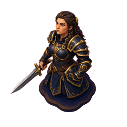 [Cx] Cold Xena, warrior woman [I use (calculator) to (baton)] [complex (blender)] [over a (tweezers)] [(glass divider).]
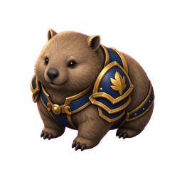 [Cw] Cold wombat [I use (stamp) to (hammer)] [a temporary (window)] [that acts as a (hologram)] [(desk).]
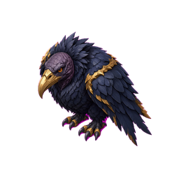 [Cv] Cold vulture [I use the (magic wand) to (football)] [a standard SQL (yarn)] [into the (lightning)] [(engine block).]
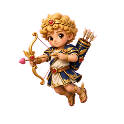 [Cu] cupid [I use (sparkler) to (zipper)] [standard SQL (magnifying glass)] [with my PySpark (grid)] [(keyboard).]

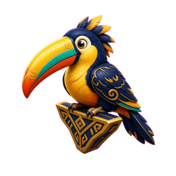 [Ct] Cold toucan [I use this (padlock) to prevent] (shield) [at the cost of (maze).] — Note: Retrieving a complete record is slower than a star schema because it requires multiple SQL JOIN operations.
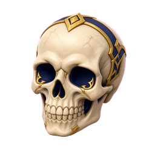 [Cs] Cold skull [I use a (snowflake) to center] [my (abacus)] [inside highly (stairs).] — Note: This eliminates data redundancy and saves storage by storing each category exactly once.

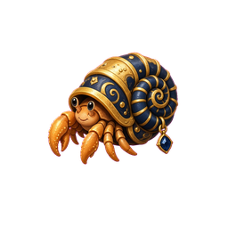 [Cr] crab (hermit) [I use (lemon) to guarantee] [that database transactions are processed (shield) during system failures.]

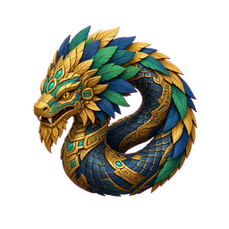 [Cq] Cold Quetzalcoatl [I use a (window) to generate] [a (hologram) from a saved SQL query.]
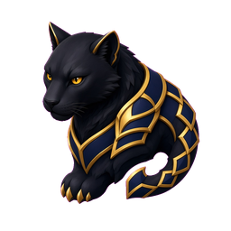 [Cp] Cold panther [I use (scale) to contrast] [building the (pipes) against inspecting the water.]
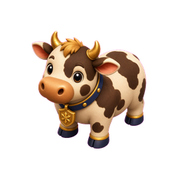 [Co] cow [I use (hard hat) to build] [the (pipeline) necessary to collect and process data at scale.]
 [Cn] Cold Neanderthal [I use (lightning bolt) to process] [large-scale data across a (factory) framework.]
 [Cm] Cold marmoset [I use a (map) to trace] [the (plant) of data across different systems.]

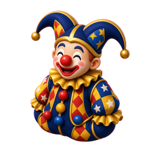 [Cl] clown [I use (shield) to track] [the exact (recipe) of transformations from the original source.] — Note: This lineage provides fault tolerance by allowing Spark to recompute lost data deterministically.
 [Ck] Cold kitten [I use a (blueprint) to map] [my (string) of data transformations without any loops.]
 [Cj] Cold jester [I use (brain) to retain] [active datasets directly in (ice cube).] — Note: This drastically reduces slow disk I/O operations.
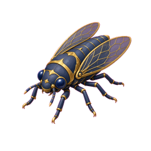 [Ci] cicada [I use a (crown) to distribute] [massive data workloads across multiple (forklift).]

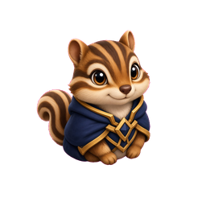 [Ch] chipmunk [I use (passport) to propagate] [(stamp) automatically to all linked environments.]
 [Cg] Cold goat [I use (leash) to restrict] [my datasets exclusively to the (triangle).]
 [Cf] Cold frog [I use the (namespace) to reference] [my data using a catalog, (schema), and table format.]

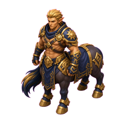 [Ce] cenotaur [I use (role) to distribute] [(governance) responsibilities across the account and metastore.]
 [Cd] Cold dragon [I use the (metastore) to manage] [my (metadata) across modern cloud object storage.]
 [Cc] Cold cat [I use (catalog) to centralize] [access (control) and data discovery across all workspaces.]
 [Cb] Cold bird of paradise [I use the (workspace) to share] [items that my entire (team) needs to view.]
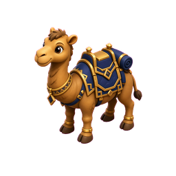 [Ca] camel [I use the (catalog) to explore] [accessible SQL (table) through a graphical interface.]

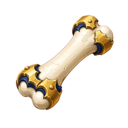 [Bz] Bone Zeus [Databricks (hardhat)] [I (magic wand) my interactive notebooks] [into scheduled (factory) pipelines] [with strict task (handcuffs)]
 [By] Byron [Interactive (spiral pad)] [I (pen) my logic] [using multiple programming (dictionary)] [within the same (puzzle) interface]
 [Bx] Bone Xena, warrior woman [Databricks (desk)] [I (handshake) with data] [through an (blanket) layer] [that sits over (sushi) files]
 [Bw] Bone wombat [Compute (gears)] [I configure Spark (robot)] [to (guillotine) automatically] [after a period of (hammock)] — Note: This prevents wasted cloud spend when the resources are not being used.
 [Bv] Bone vulture [Databricks (apple)] [I process data with (lightning)] [store it in (triangle) Lake] [and manage (beaker) with MLflow]

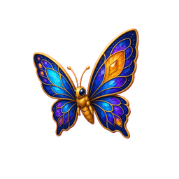 [Bu] butterfly (razor) [I keep my fact table (ruler)] [by storing only keys and (safe)] [while placing descriptive fields in (drawer)]

 [Bt] Bone toucan (brass key) [I assign an artificial unique (barcode)] [inside a (cabinet) table] [to maintain (handcuffs) relationships] — Note: Has no business meaning and prevents broken links when natural names change.
 [Bs] Bone skull (steamroller) [I (glue) related data] [into fewer (bench) tables] [to (speedometer) up analytical queries] — Note: Normalization splits data across many small tables to reduce redundancy for transactions.
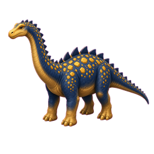 [Br] brontosaurus (tag) [I store descriptive (label)] [that give (lens) to numerical facts] [for (funnel) and grouping]
 [Bq] Bone Quetzalcoatl (abacus) [I store quantitative (chest)] [at the (bullseye) of the schema] [(chain) to surrounding dimensions] — Note: Kept lean and numeric by excluding descriptive text fields.
 [Bp] Bone panther (badge) [I (binder) data into a central fact table] [(fence) by dimension tables] [to (rocket) querying and reporting]

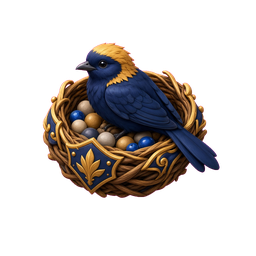 [Bo] bower-bird (button) [I (hose)] [directly into (battery)] [using its (menu)] — Note: This method does not support relationships or joins, so all complex data models must be flattened before ingestion.
 [Bn] Bone Neanderthal (scroll) [I (quill)] [to (fishing rod)] [and (dump truck)] [into a (forklift)] — Note: This provides unmatched flexibility and optimization for big data, but requires significant coding complexity and infrastructure maintenance.
 [Bm] Bone marmoset (spider web) [I (cable)] [to (battery)] [by (dial)] (address bar) — Note: This method is free and simple for one-time imports but lacks scalability for rate limits or complex authentication.
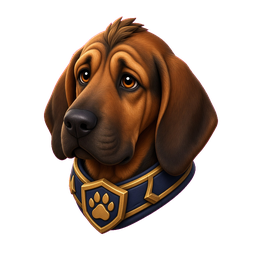 [Bl] bloodhound (magic wand) [I use an (bridge)] [to (plug)] [to (battery)] [in a (robot)] — Note: These platforms clean messy responses and schedule updates but may lack support for complex mechanics like pagination.

 [Bk] Bone kitten (syringe) [I (needle)] [directly into an (open book)] [using a (blanket)]
 [Bj] Bone jester (test tube) [I (tweezers)] [for an (blender)] [without changing the (sandglass)]
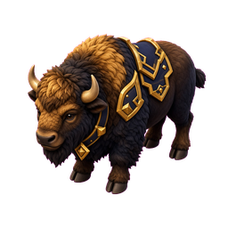 [Bi] bison (glass divider) [I (pizza slicer)] (cubicle) [and (abacus)] [while (magnifying glass)] — Note: GROUP BY reduces the output by collapsing multiple rows into a single summary row.
 [Bh] Bone Hydra (lagging foot) [I (magnifying glass)] [from (footprints)] [relative to the (anchor)] — Note: It requires an explicit ordering clause and evaluates to null when a preceding row does not exist.

 [Bg] Bone goat (outer space) [I return all (vinyl record)] [from (table)] [and fill any missing sides with (ghost)] — Note: It essentially combines the results of both a left join and a right join.
 [Bf] Bone frog (left hand) [I return all (vinyl record)] [from the (table)] [and fill missing right matches with (ghost)]
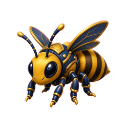 [Be] bee (bullseye) [I return only the (vinyl record)] [that have (puzzle piece)] [in (twins)] — Note: Unmatched rows are completely excluded.

 [Bd] Bone dragon (lasso) [I (vacuum) any non-aggregated column] [from the (menu)] [inside the (folder)] — Note: This ensures identical data combinations correctly collapse into a single summary row.
 [Bc] Bone cat (funnel) [I (coffee filter) summary rows] [after they have been (blender)] [by the GROUP BY (snowball)] — Note: The WHERE clause filters individual rows before any data grouping occurs.
 [Bb] Bone bird of paradise (tent) [I (freezer) the output of heavy computation] [in a (clipboard)] [to prevent the database from (hamster wheel) it] — Note: CTEs re-execute from scratch each time, which is inefficient for massive datasets.
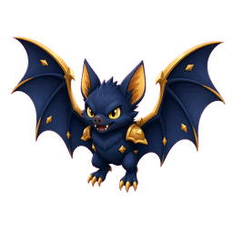 [Ba] bat (dashboard) [I (tweezers) nested subqueries using CTEs] [and apply (window)] [to (scales) specific data subsets] — Note: This combines structural organization with advanced analytical evaluations in a single query.

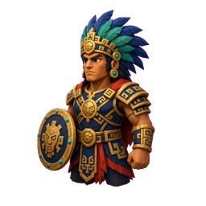 [Az] Aztec [(shuffle): I change marks and (dial) values] [so the new layout can change what I (lightbulb)]
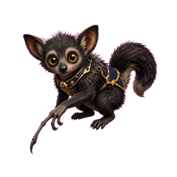 [Ay] aye-aye [(twin) Controls: I show two windows together] [(map) plus enlarged (lens) of one area]

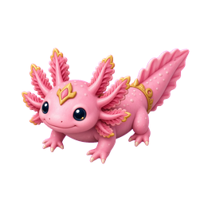 [Ax] axolotl [(magnifier): show focus and (frame)] [in the (stretch) visual structure at once]
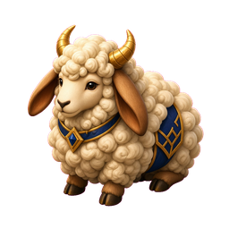 [Aw] awassi sheep [(pin) Investigations: I use a data mark's location] [to (flashlight) extra table (card)]
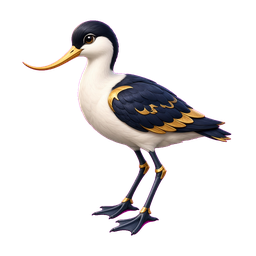 [Av] avocet [View (switch): creates new (window)] [of the visual structure] [for my (wrench)]
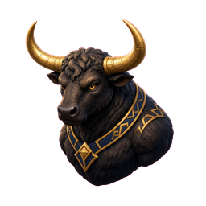 [Au] auroch [Dense (mosaic) Displays: I (tile) each value to individual pixels] [and form a (shape) per data dimension]
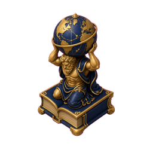 [At] atlas [(puppet): a graphic entity] [whose (dial) are (remote) by data attributes]

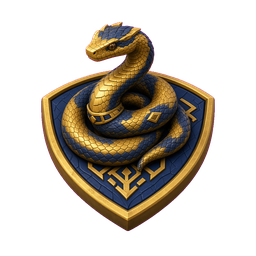 [As] asp [Parallel (ribbon): like Parallel Coordinates] [but focused on (tag) variables]
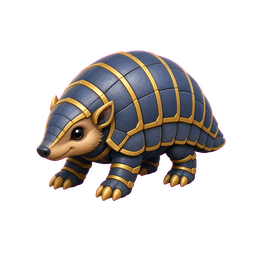 [Ar] armadillo [Table (shuffle): I combine reordering, bar-sized (bar), and semantic (lens)] [by row and column]
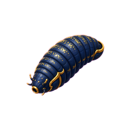 [Aq] aquatic leech [(clock) Axis Techniques: I use polar axes] [to study (loop) events and (calendar)]
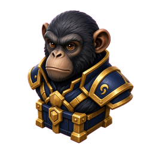 [Ap] ape [(fence) Coordinates: I draw each variable as a parallel axis] [and turn each (bead) into a (wire)]
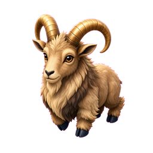 [Ao] aoudad [(crayon) Line Charts: I tell dimensions apart] [by color, (rope), or line (stripe)]

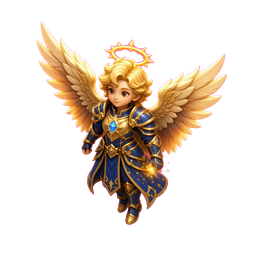 [An] angel [(ring): I place N anchors on a circle] [and (magnet) points by (spring) spring balance]
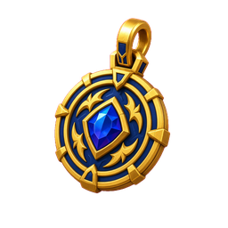 [Am] amulet [(stopwatch): fast easy (magnifier) of data] [with as few interpretation (eraser) as possible]
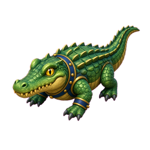 [Al] alligator [(truth): my visual mapping must express all table (ledger)] [and (filter) that data]
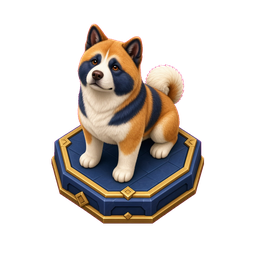 [Ak] Akita (dog breed) [(flashlight) Visual Processing: I aid search and pattern detection] [with automatically (pop) properties] [like (paint) and size]
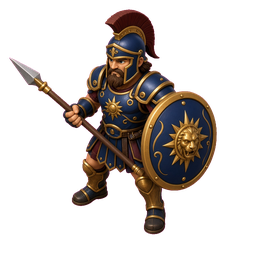 [Aj] Ajax [Visual (plug): I link each data-table (dial)] [to a graphical or spatial (paint)]

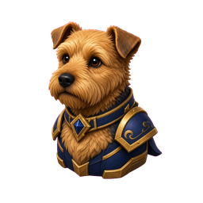 [Ai] Airedale terrier [Small (stamps): they force visual (eyes)] [of changes, differences, and (fork)]
 [Ah] Ah!—a sigh [(toy): objects present] [in the (frame) (room)] — Note: Marks use graphical and spatial properties to show data values.
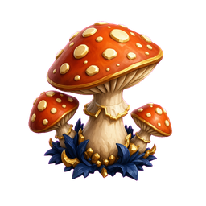 [Ag] Agaric fungi [Spatial (stage): the area available] [to (screen) the (box)]
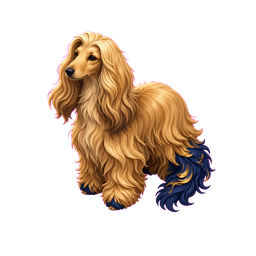 [Af] Afghan hound [Visual (kit): the set of visual elements] [that (mirror) a (box)]
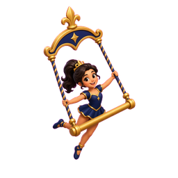 [Ae] aerialist [Database (blueprint): I treat it as the structural blueprint] [of my (building)] [including tables, fields, (chain), and constraints]

 [Ad] adder [I store data without fixed (cloud)] [using flexible (origami)] [for horizontal (accordion)] — Note: Uses documents, key-value pairs, wide columns, or graphs to adapt easily to changing schemas.

 [Z] Zeus [My unpivot step automatically (trash can) all rows] [with (ghost) values] — Note: Power Query has no built-in setting or parameter to turn off this automatic removal.
 [Y] yak [I unpivot multiple (pillar) into rows] [to (clay) my data more easily] — Note: Column headers become an attribute column paired with a single value column.
 [Ac] acorn [I (chest) data] [in rigid (grid) of rows and columns] [linked by predefined (chain)] — Note: Enforces schemas and data integrity using SQL validation rules.
 [Ab] Abyssinian cat [I (stamp) my query steps] [across different (binder)] [sharing the exact same table (twin)] — Note: Identical column headers and data formats are required so the query steps run without error.
 [Aa] aardvark [I replace nulls with a temporary (scarecrow)] [before (jack)] [to (boomerang) them back afterward] — Note: This prevents Power Query from dropping rows during the unpivot step.

<strong>Dogs</strong> · 3 palaces · 8 atoms

 [H] Hydra (scale) [I offer (turkey)] [to (hurdle) games] [when (shoe) are taken] — Note: Chasing turns theft into a self-reinforcing game.
 [G] goat (perfume) [I rub authorized (bone)] [between my (palms)] [to transfer (shirt)] — Note: Overnight contact with the handler also works to fulfill scent drives.

 [F] frog [(tightrope) Training] [I (leash) the dog] [over raised Cavaletti (hurdles)] [to build (bumper) awareness] — Note: This scientifically supports joint health and combats dysplasia risks.

 [E] eagle [Controlled (shield)] [I play (rope)] [paired with a (parachute) command] [to channel instinctual (battery) safely] — Note: This structured game tires out high-drive dogs effectively.
 [D] dragon [(nose) Work] [I (seeds) food] [across the garden (mower)] [to engage (magnifying glass) instincts] — Note: Hiding food around the house with a go find command also works.
 [C] cat [Basic (whistle)] [I teach the (mat) command] [to build sustained (laser)] [and provide mental (brain)] — Note: This improves communication without needing advanced sports training.
 [B] bird of paradise [Proper (trophy)] [I (scale) the dog] [with predictable (clock)] [and cognitive (nose) games] — Note: High drive can be satisfied through structured play and scatter feeding rather than professional sports.
 [A] Arachne [Breeding (ruler)] [I choose (hardhat) lines] [for extreme (fire)] [and (leash) lines] [for calm (heart)] — Note: Show lines prioritize physical conformation and structure.

<strong>Piano</strong> · 1 palace · 5 atoms

 [Ap] ape Musical note names must be written in uppercase letters because lowercase letters represent different concepts in music theory notation.
 [Ao] aoudad Treble F is located in the first space at the very bottom of the treble staff
 [An] angel Moving to an adjacent white key on the piano means stepping between a line note and a space note on the musical staff.
 [Am] amulet Middle C for the left hand is drawn with a downward stem on a ledger line above the bass staff.
 [Al] alligator Bass F sits on the second line from the top and acts as a symmetrical mirror image to Treble G around Middle C.

