# Mnemonic Study System

This system helps you memorize complex topics (e.g. Piano, English Grammar, Communication) by combining a **Bestiary** (beasts as concept holders) with a **Memory Palace** (unique geolocations). Each knowledge atom is anchored to a Beast on a Street, with Actions to make recall vivid and durable.

**Reading order:** Read Quick Start and the workflow diagram once. Prompt templates live in `studies/technique/prompts/`; each prompt's **Input (always last)** section lists what to attach (lines starting with 📎).

> **For AI runs:** When a prompt cites `README §<Section Name>`, that section under **Canonical Rules** is the single source of truth. Do not invent rules outside those anchors. Topic-specific concepts come from the video transcript and `plan.md`; the general framework and mnemonic rules live here—attach this README for Story Architect and Story Reduction; do **not** add a separate "theory" paste.

---

## Quick Start

**Constraint:** Cursor IDE AI cannot access YouTube. Produce the transcript in a web AI (e.g. Gemini), then use that transcript in Cursor for story generation and later steps.

| Step                         | Owner                | Prompt / action                                                                                                    | Attach (📎)                                                                                      |
| ---------------------------- | -------------------- | ------------------------------------------------------------------------------------------------------------------ | ------------------------------------------------------------------------------------------------ |
| **0 — Plan**                 | You                  | Open `studies/[topic]/plan.md` for topic research, video picks, checklists                                         | —                                                                                                |
| **1 — Watch**                | You                  | Watch the recommended YouTube video enough to grasp the concept                                                    | —                                                                                                |
| **2 — Transcribe**           | Gemini               | `prompts/video-transcription-prompt.txt`                                                                           | YouTube video link                                                                               |
| **3 — Curate atoms**         | Cursor (when needed) | `prompts/concept-curation-prompt.txt` — when the transcript/text is too long or dense                              | Source transcript/text · optional practice `.md` · this README                                   |
| **4 — Story Architect**      | Cursor               | `prompts/story-prompt.txt`                                                                                         | Transcription **or** curated concept `.md` · existing study list · `bestiary.json` · this README |
| **5 — Story Update**         | Cursor (when needed) | `prompts/story-reduction-prompt.txt` — the instruction says what to change                                         | In-scope palace pack · the instruction · `bestiary.json`                                         |
| **6 — Maps capture**         | You                  | Google Maps: **N** locations, one Street View screenshot per street                                                | Use latest `🖼️ Mnemonic image prompts` from step 4 or 5                                          |
| **7 — Foreground composite** | External image AI    | `prompts/image-background-preservation-prompt.txt` **above** matching street line from `🖼️ Mnemonic image prompts` | Street screenshot · matching image prompt line                                                   |
| **8 — Save files**           | You                  | Store snapshots and composites in `studies/[Topic]/images/` as `N.png` matching Street N                           | —                                                                                                |
| **9 — Markdown assembly**    | You                  | Paste finalized story into `mnemonics-<topic>.md`; set `` links                           | —                                                                                                |

**Key terms:**

- **Plan Document:** `studies/[topic]/plan.md` — topic-specific research and video recommendations.
- **Mnemonic framework:** Topic-specific concepts come from the plan document **and** the video transcript. The **general framework** and rules for this system live **in this README**.

When extending an existing list, the AI MUST track previous list state so new atoms are merged without duplication. Isolated facts still require a video transcript and the normal Story Architect / Story Reduction flow—there is no separate shortcut prompt.

---

## Workflow diagram

```mermaid
%%{init: {'theme': 'dark', 'themeVariables': {'fontSize': '16px', 'edgeLabelBackground': '#ffffff', 'edgeLabelColor': '#0d0d0d', 'primaryTextColor': '#e8e8e8'}, 'flowchart': {'htmlLabels': true, 'padding': 16}}}%%
flowchart TB
  subgraph prep [Prep — everyone]
    planNode["<b>Plan</b><br/><br/><span style='color:#9cdcfe'>You:</span> Open <code>plan.md</code> for video link, topic, checklists.<br/><span style='color:#888'>No AI.</span>"]
    watchNode["<b>Watch</b><br/><br/><span style='color:#9cdcfe'>You:</span> Watch enough to understand the lesson."]
  end

  subgraph pathPostTranscript [Post-transcript pipeline]
    transcribeNode["<b>Transcribe</b> — <code>video-transcription-prompt.txt</code><br/><br/><span style='color:#c586c0'>📎</span> <span style='color:#dcdcaa'>YouTube video link</span> <span style='color:#888'>(Gemini · Input section)</span><br/><br/><span style='color:#9cdcfe'>You:</span> Paste the link in Gemini.<br/><span style='color:#b5cea8'><b>Save</b></span> Markdown transcript.<br/><span style='color:#888'>Required before Story Architect (or Curate).</span>"]
    curateNode["<b>Curate atoms</b> — <code>concept-curation-prompt.txt</code><br/><br/><span style='color:#c586c0'>📎</span> <span style='color:#dcdcaa'>Source transcript/text · optional practice <code>.md</code> · README</span><br/><br/><span style='color:#9cdcfe'>You:</span> when the source is too long/dense.<br/><span style='color:#b5cea8'><b>Save</b></span> curated concept Markdown.<br/><span style='color:#888'>Optional; feeds Story Architect as transcription.</span>"]
    storyNode["<b>Story Architect</b> — <code>story-prompt.txt</code><br/><br/><span style='color:#888'>Match <b>Input (always last)</b> in the prompt; attach with <code>@</code>:</span><br/><span style='color:#dcdcaa'>📎 Transcription <b>or</b> curated concept <code>.md</code> · 📎 Existing study list <code>.md</code> · 📎 <code>bestiary.json</code> · 📎 <code>studies/technique/README.md</code></span><br/><span style='color:#888'>Framework rules: covered by the README attachment (no extra theory paste).</span><br/><br/><span style='color:#ce9178'><b>You get:</b></span> <code>Total streets required: N</code> · new streets · image placeholders · <code>🖼️ Mnemonic image prompts</code> <span style='color:#888'>(no per-street tracking comments)</span>."]
    refineNode["<b>Story Update</b> — <code>story-reduction-prompt.txt</code><br/><br/><span style='color:#dcdcaa'>📎 The instruction · 📎 In-scope palace pack · 📎 <code>bestiary.json</code></span><br/><span style='color:#9cdcfe'>You:</span> say what should change in one note: update some beasts and delete others, merge some, or replace a deprecated concept<br/><span style='color:#ce9178'><b>You get:</b></span> one updated palace pack · refreshed <code>🖼️ Mnemonic image prompts</code>. Do not rewrite narratives. One beast keeps one atom. If the instruction is unclear, the model asks before it edits."]
    mapsNode["<b>Google Maps</b><br/><br/><span style='color:#9cdcfe'>You:</span> N locations · one screenshot per street.<br/><span style='color:#888'>Use the latest <code>🖼️ Mnemonic image prompts</code> from the current story output.</span>"]
      genNode["<b>Foreground Composite</b> — <code>image-background-preservation-prompt.txt</code><br/><br/><span style='color:#dcdcaa'>📎 Street screenshot · 📎 Matching line from <code>🖼️ Mnemonic image prompts</code></span><br/><span style='color:#9cdcfe'>You:</span> place the preservation prompt above the street prompt, then add mnemonic foreground elements without altering the place."]
    filesNode["<b>Save files</b><br/><br/><span style='color:#9cdcfe'>You:</span> Study <code>images/</code> folder · save as <code>N.png</code> matching Street N."]
    mdNodeA["<b>Markdown assembly</b><br/><br/><span style='color:#9cdcfe'>You:</span> Paste story into <code>mnemonics-&lt;topic&gt;.md</code> · set <code>images/N.png</code> links."]
  end

   planNode --> watchNode --> transcribeNode --> curateNode --> storyNode --> refineNode --> mapsNode --> genNode --> filesNode --> mdNodeA

  classDef human fill:#243524,stroke:#5d9a5d,stroke-width:2px,color:#e8e8e8
  classDef ai fill:#1a3048,stroke:#569cd6,stroke-width:2px,color:#e8e8e8

  class planNode,watchNode,mapsNode,filesNode,mdNodeA human
  class transcribeNode,curateNode,storyNode,refineNode,genNode ai
```



**Legend**

| Node fill (dark preview) | Meaning                                                                                                            |
| ------------------------ | ------------------------------------------------------------------------------------------------------------------ |
| **Green-tinted**         | Human-primary: you act without a chat/model paste as the main step (plan, watch, Maps, save files, edit Markdown). |
| **Blue-tinted**          | AI-primary: transcript in Gemini; Curate / Story / Reduction; foreground composite.                                |

**Inside nodes:** **📎** = attach that item to context (matches the prompt file's **Input (always last)** section; in Cursor use **`@`** on files). **Pale yellow** = paste into that AI; **orange** = model output; **blue** (label text) = your actions; **gray** = notes.

_Read **top to bottom** inside each subgraph. After prep, the pipeline is linear: transcript → optional Curate → Story Architect → reduction when needed → Maps, image composition, and Markdown._

---

## Canonical Rules

All prompts cite these sections by exact heading name (`README §<Heading>`). Rules MUST NOT be duplicated or contradicted elsewhere.

### Knowledge Atom Structure

**Definitions:**

- **Knowledge Atom:** The complete entry/record for a single concept.
- **Peg:** Letters from the Bestiary as singles **and** pairs (e.g. A, AB). NEVER use numbers.
- **Knowledge / Definition (`concept` / Context):** The rehearsal summary the user reads on active recall. Always written as `💡 **Context:** …` (CSV field `concept`). **Maximum compression:** use the fewest words that still preserve **100%** of the semantic meaning and critical conceptual logic—zero information loss; NEVER truncate or omit essential logic for brevity. Purpose: minimize cognitive and mnemonic load during recall. **Keyword sentence (HARD) — new atoms only:** The compressed core is 4–5 square-bracket groups that read as one grammatical sentence, separated by a single space. Group 1 is `[I use {formal concept name} to {bare verb}]`. Use the source’s standard label (section title, named technique, or established term) inside that clause. First person singular. No period at the end of group 1. The name sits inside the clause; NEVER give it its own brackets, NEVER write `[Name: definition]`, and NEVER emit a description-only core when a clear name exists. Each later group continues that same sentence (object and complements). None of them starts a new subject or a second “I …”. Four or five groups are required so the atom has five or six keywords. Do **not** use `|` to split concept groups. Do **not** bracket the optional Note. **Legacy atoms:** stored rows keep their existing `concept` text. Do not rewrite them into this shape. **Conditional Note:** when nuance, complexity, or verbosity was deliberately stripped from the compressed core to keep extreme brevity, append that supplementary context in the same Context/`concept` field as ` — Note: <nuance>` after the groups. The Note stays **impersonal / third person**—not first person. If no compression trade-off was needed, omit the Note. NEVER confuse this with Quote.
- **Keywords (`keywords`):** Ordered association pairs from the concept core. Store each as `Keyword | RecognizableWord`, joined with `||`. A **new** atom has **5–6** pairs: two from group 1 (formal name, then the bare infinitive after `to`), then exactly one from each later group. **Keyword** = tangible memory anchor (physical object, action, actor, or cartoon character). **RecognizableWord** = one concrete word taken from that same group — never a multi-word abstract phrase such as “complex query joins”. Key `joins` and `complex` separately when both matter. Pair 1’s RecognizableWord is the formal concept name from group 1 (renders blue; the name may be multi-word). Pair 2’s RecognizableWord is the bare infinitive after `to` in group 1 (`prevent`, `center`, `guarantee`, `convert`, …) and always gets its own keyword. Each later pair’s RecognizableWord is a single concrete word from that group (renders orange). Preserve exact left-to-right order in storage and display. Display under Concept in practice MD and the web SPA as `[word] → [keyword]`. Never invent pairs for Note text. Keywords are the recall cue the user turns into a story later. **AIB does not write that story.** Legacy atoms keep their existing `keywords` string.
- **Quote:** Direct transcript excerpt from the video source, verbatim. NEVER prefix Quote with `💡`. NEVER append a `Note:` to Quote.

**Sensory channel emojis** (required beside every `· sensory:` marker on an `🟧` beast header; channel word first, then its emoji):

| Channel   | Emoji |
| --------- | ----- |
| visual    | 👁️    |
| auditory  | 👂    |
| tactile   | ✋    |
| olfactory | 👃    |
| gustatory | 👅    |
| thermal   | 🌡️    |

Format: `· sensory: [channel] [emoji]` (e.g. `· sensory: visual 👁️`). NEVER invent other sensory emojis; NEVER omit the emoji; NEVER place the emoji before the channel word.

**Allowed emojis (Story Architect / Story Reduction output):** Only `🟧` (beast header), `💡` (definition / `**Context:**` line), and the sensory-channel emojis above—plus the fixed section title `🖼️ Mnemonic image prompts` required by the output contract. NEVER invent any other emoji in beast headers, Context, Quote, summaries, or image-prompt body text. Do not encode a second knowledge atom with `🟦`.

**Structure per Knowledge Atom** (separated by clear line breaks):

1. **Header:** `🟧` `[Peg Letters]` `[Beast Name]` `· sensory: [channel] [emoji]` — required sensory channel for the main topic, with its mapped emoji from **Sensory channel emojis** above.
2. **Definition (Context):** `💡 **Context:** [I use {Name} to {verb}] [{continuation}] [{continuation}] [{continuation}]` — fewest words, full semantic fidelity. MUST start with `💡`. **Keyword sentence (HARD):** 4–5 bracket groups that read as one sentence, so the atom has 5–6 keywords. Group 1 is `I use {formal name} to {bare verb}` with no closing period. Each later group continues that sentence and does not start a new “I …”. This is the main rehearsal element; it is NOT the Quote. When nuance was stripped from the compressed core, append ` — Note: <stripped nuance>` in the same Context/`concept` field (Note stays impersonal and unbracketed). Applies to newly authored atoms. Existing atoms keep their stored concept.
3. **Keywords:** After Context, list ordered association pairs (one per line as `[RecognizableWord] → [Keyword]`, or CSV `keywords` as `a | b || c | d`). A new atom has 5–6 pairs: formal name from group 1, bare infinitive after `to` from group 1, then one single concrete word from each later group. Never key a multi-word abstraction. Supports dual-access cues under Concept. The user writes any mnemonic story later from these keywords. AIB leaves CSV `story` empty and does not author a narrative. Existing atoms keep their stored keywords.
4. **Quote (Target Payload):** Direct video quote, verbatim from the transcript. NEVER use `💡` on Quote. NEVER append a `Note:` to Quote.

**Retrieval path:** peg → `💡 **Context:**` (ultra-short core + optional Note) → **Keywords** → Quote. The user may later turn the keywords into a story outside this system. AIB does not write that story.

**One atom per beast:** A beast holds exactly one Knowledge Atom. Do not keep several atoms on one beast, and do not split an atom across body zones. Story Update follows the human's instruction in one pack. That instruction may update some beasts and delete others together, merge named concepts into one new atom, replace a deprecated concept, or name another edit.

**Example:**

```md
🟧 **[B] [bird of paradise]** · sensory: visual 👁️

💡 **Context:** [I use Past Perfect to mark] [an action finished before another past action.] — Note: Form it with had plus the past participle.

**Quote:** "The past perfect uses had plus the past participle."
```

**Output quality:** Format optimized for both text reading and Read Aloud (TTS). Maintain strict visual separation (line breaks) between every Knowledge Atom.

### Streets and Depth Slots

Locations taken from your hometown, e.g. using Google Maps.

- **Crucial constraint:** Maximum **5 Beasts per Street**. NEVER place more than 5 Beasts on any single street.
- **Shared street background (visual only):** All beasts on a street composite into the **same Google Maps background**—but each beast occupies a **distinct depth slot** with a **structural anchor** within that image.
- **Street packing (minimize street count):** Applies to **new streets/Memory Palaces created in the current Architect run (this pack) only**. Assign **exactly 5 beasts to each new street**. The **only** new street allowed to have fewer than 5 beasts is the **last new street in that run** — and only when the remaining **new** beast pool is < 5. Example for 16 new beasts: `5+5+5+1` (remainder on the last new street), **never** `1+5+5+5` / `1+5` / sparse new street then fuller later new streets. NEVER leave an earlier **new** street sparse while any later **new** street exists. Existing under-filled streets already in the study stay as-is — do **not** top them up to 5.
- Streets are dynamically assigned per study topic; the Story Generator MUST state **how many** streets the topic requires (`Total streets required: N` = ceil(beast_count / 5)).
- A later continuous session leaves every existing under-filled street untouched and adds **new** streets packed 5-at-a-time with remainder only on the newest last street of that run. Continue peg letters after the last existing peg; start new street numbers after the highest existing street/palace number.
- **No named character:** Do not assign a real person or a copyrighted character to a street. Leave `character_name` blank.
- **Maps capture tip (user):** Prefer Street View locations with visible depth cues—facades, roofs, gates, corners—not flat homogeneous pavement filling the frame.

**Depth slots (Fan Effect mitigation):**

Five beasts on one street is high-density loci (near working-memory limits). Similar backgrounds (e.g. all pavement) cause proactive interference and **Fan Effect** slowdown. Mitigation: mandatory **depth slots**—fixed Z-axis + lateral coordinates—without reducing the 5-beast target or Google Maps backgrounds.

| Beast order on street | Depth slot           | Placement rule                                                                                        |
| --------------------- | -------------------- | ----------------------------------------------------------------------------------------------------- |
| 1st                   | **ForegroundLeft**   | Near camera, left third; anchor to a distinct structure (gate, wall, vehicle)—not open pavement alone |
| 2nd                   | **MidgroundRight**   | Mid depth, right third; distinct structural anchor                                                    |
| 3rd                   | **BackgroundCenter** | Far depth, center line; facade, end of street, or distant landmark                                    |
| 4th                   | **Aerial**           | Elevated: roof, wall top, lamp post, tree branch, balcony                                             |
| 5th                   | **ForegroundRight**  | Near camera, right third; distinct structural anchor                                                  |

- **One beast per depth slot** on a street; NEVER two beasts in the same slot.
- **Separate places:** each beast is a different location in the 3D scene, with clear empty space between them. NEVER a huddle, a line-up, overlapping bodies, or two beasts on the same structure. A person must be able to point to each beast as its own spot.
- **Fewer than 5 beasts:** use the **first N slots in order**.
- **Structural anchor required:** bind each beast to a **named feature** in the Maps scene (roof, gate, bench, lamp post, parked car, corner)—not "on the sidewalk" or "on pavement" alone when a structure exists in frame.
- Image prompts MUST state **`Depth slot:` + structural anchor** per beast.

### Independent Beast Beats

- Each beast is a **self-contained retrieval unit**. Its concept, keywords, and quote encode only **its** one knowledge atom. The street does **not** share a narrative thread, shared props, or cross-beast story links. AIB does not write the user's story.
- **Any-order recall:** Random access works because each beat is isolated at its **depth slot**—not because the user reconstructs sibling beasts via shared props, environmental cues, or thematic echoes.
- **No fixed chain language:** NEVER imply a required sequence like "next", "then", "after this beast", or "Beast 1 → Beast 2 → …".
- **Beast-to-beast interaction (optional, default none):** Direct links between beasts are allowed **only** when they serve the concept, transcript logic, or a stronger mnemonic. Do not add generic references to other beasts on the street (e.g. shouting, bleating, or waving at a nearby beast) when there is no meaningful link. NEVER require reading another beast's narrative to decode this one.

### Bizarreness Gate

LLMs default to plausible, coherent scenes. Memory athletes need the **improbable**. Apply this gate to **image prompts** (bizarre foreground detail). AIB does **not** write a Knowledge Atom story; the user writes that later from the keywords. Mundane associations decay; bizarre ones stick.

Each image-prompt beat MUST include **at least one** improbability lever:

| Lever                      | Rule                                               | Example                                                                                |
| -------------------------- | -------------------------------------------------- | -------------------------------------------------------------------------------------- |
| **Physics violation**      | Impossible motion, matter, or causality            | Beast phases through the gate while freezing solid neon grammar dust mid-air           |
| **Disproportionate scale** | Beast or prop drastically wrong size vs the street | Microscopic elephant perched on a gate post; skyscraper-tall ant straddling the facade |
| **Sensory juxtaposition**  | Clash two senses in one beat                       | Deafening silence visible as ripples; chalkboard dust that **tastes** like thunder     |

- **Reject mundane defaults:** If the beat could pass as a normal documentary caption, rewrite until at least one lever is obvious.
- **Image prompts:** Carry the same lever into foreground description (state scale or surreal detail explicitly when used).

### Actions palette

How you imagine interacting with a Beast. A Character MAY perform the interaction in the scene instead of you. Use:

- **Tangible** — touch, weight, texture
- **Grotesque** — exaggerated, bizarre, unsettling, but non-graphic
- **Sensual** — adult-safe, non-explicit tension, attraction when it materially improves recall
- **Strange** — unexpected, surreal
- **Impactful** — loud, dramatic, startling, high-stakes without graphic harm

These are the **tools** for passing the **Bizarreness Gate**—not optional decoration on easy beats.

NEVER add moderation-bypass language, explicit sexual content, or graphic gore. Favor memorable but platform-safe imagery.

### One atom per beast

A beast holds exactly one Knowledge Atom. Body zones are not knowledge slots.

- Do not keep several atoms on one beast.
- Do not assign atoms to Z1–Z4, and do not use `kind=zoned`.
- When a palace needs a change, run **Story Update** once and say what to do. One instruction may update some beasts and delete others, merge named concepts into one atom, replace a deprecated concept, and pull the next beasts forward. Each remaining beast still carries exactly one atom.
- Older libraries that once stored extra atoms on one beast keep that text in `beast_notes`. Those notes are not a second atom.

### Characters

Named public figures and copyrighted characters are not street anchors. `characters.json` is an empty catalog. Leave `character_name` blank.

- Do not assign a real person, historical figure, celebrity, or copyrighted character to a street.
- Do not put those names in `character_name`, PREVIEW titles, stories, or `image_prompt`.
- Streets are recalled through their beasts and the place. Do not add a named character when removing streets.

### Language & IPA

**Default to simple English everywhere you write** (Context, image prompts, quality summary): short everyday words, concrete images, zero fluff. For **Context/`concept`**, prefer maximal compression (fewest words, full meaning). A newly authored core is the two-part sentence in `README §Knowledge Atom Structure`; leave any ` — Note:` impersonal. Existing atoms keep their stored concept. Image prompts stay third-person beast scenes—write those as if explaining to a curious teenager, not an academic paper or period novel. Do not write a mnemonic story.

**Banned in your own prose (unless inside a preserved quote or a Context `Note:`):** Archaic, old-fashioned, or literary diction; rare or show-off vocabulary; stiff textbook wording; Latin/French roots where a common Anglo-Saxon word works; idioms that need a dictionary; discipline jargon, acronyms, and technical terms **unless** the transcript quote requires them—and even then, keep the exact term in the Quote when needed and compress the idea in Context (append nuance as ` — Note:` on Context/`concept` if the compressed core cannot hold it briefly).

**Replacement rule:** If you would use a hard word, swap it for a simpler one (e.g. _use_ not _utilize_, _end_ not _terminate_, _try_ not _endeavor_, _show_ not _demonstrate_ unless _demonstrate_ is in the quote; _eat_ not _devour_ when eating is not the bizarre lever). Keep scale/improbability levers for the Bizarreness Gate—simplify the diction, not the spectacle.

**Read-aloud test:** Image-prompt sentences SHOULD sound natural when spoken aloud; if stiff, archaic, old-fashioned, or textbook-like, rewrite more simply. Context/`concept` MAY be telegraphic (compressed phrases) as long as meaning stays complete.

**Preserve quotes:** The verbatim transcript excerpt MUST stay exact—do not simplify or modify the quoted characters. The optional ` — Note: …` suffix is authored prose on Context/`concept` only; it is never part of Quote.

**German words and IPA (when German appears):**

- German usually appears only a few times per output; whenever it does, the user MUST be able to **pronounce** it using **IPA** (International Phonetic Alphabet).
- **Standard:** Use **standard German (Hochdeutsch)** IPA. Prefer **broad** transcription unless narrow detail is needed for a minimal pair; use common learner-friendly symbols (e.g. stress mark ˈ before the stressed syllable).
- **Inline (Context, image prompts, quality summary):** After each German word or short fixed German phrase (about four words or fewer), append IPA in **square brackets** immediately following, with a single space before the opening bracket. Example: `The sign reads verboten [fɛɐ̯ˈboːtn̩].`
- **Inside preserved quotes:** Do **not** insert IPA inside the quoted characters (quotes stay transcript-identical). Immediately **after** the Quote line in the same Knowledge Atom, add one line starting with `IPA:` listing every distinct German word or short phrase from that quote with the same bracket style, comma-separated if several. Example: `IPA: verboten [fɛɐ̯ˈboːtn̩], Schadenfreude [ˈʃaːdn̩ˌfʁɔʏdə]`

### Peg conventions

An A–Z list of "Beasts," based on Lynne Kelly's work (_Memory Craft_). The list iterates A–Z, then AA–ZZ as needed. Entries live in `bestiary.json`.

- Each Beast holds exactly one **Knowledge Atom** (one concept; one fact). A Story Update merge replaces the named atoms with one atom. It does not put extra atoms on that beast.
- **Peg constraint:** Use the Bestiary `code` field (e.g. A, B, AB) for the Peg. NEVER use numeric identifiers (1, 2, 01, etc.).

**Two-letter pegs and Custom gap-fillers:** Beyond the primary A–Z row, pegs continue as two-letter codes (`Aa`, `Ab`, …, `Zz`). When a Lynne Kelly beast exists for that letter pair, it is used directly. When no beast fits, a **Custom** gap-filler is generated as `{physical adjective from 1st letter} + {A–Z peg beast from 2nd letter}`—for example, `Bh` → Bone Hydra (not a random hawk), `Bd` → Bone dragon.

**Mnemonic peg coloring** (GitHub strips inline CSS; use portable emoji markers):

| Marker | Scope                 | Meaning                                                                                       |
| ------ | --------------------- | --------------------------------------------------------------------------------------------- |
| `🟧`   | Beast **header line** | Peg identity for the one atom on this beast — always ends with `· sensory: [channel] [emoji]` |
| `💡`   | **Definition** line   | Maximally compressed rehearsal knowledge — always as `💡 **Context:** …`; NEVER on Quote      |

### Bestiary Shifting Logic

After Story Update, the peg sequence MUST be an **unbroken alphabetical mnemonic**. No gaps.

- **Rule:** For each **remaining** beast, in **remaining order**, assign the **next consecutive peg** from the bestiary (A, B, C, …). Update the Beast name to the beast for that new peg (from `bestiary.json`).
- **Example:** Atoms at pegs A, B, C, D, E. User removes B and D. Remaining (A, C, E) → re-pegged as A, B, C with beasts from pegs A, B, C.
- Apply this shift to the **entire** story: every Header, and every in-narrative reference to a Beast or peg, MUST use the new peg and Beast name.
- Sequence continues A, B, C, … (or A, B, …, Z, Aa, …) with no gaps.

**Story Update constraints:** Do only what the instruction asks, and do every part of it in one pack. Updating some beasts and deleting others in the same instruction is one job, not two prompts. A deletion removes those pegs and may pull the next beasts forward. A merge fuses only the named concepts into one Knowledge Atom on one beast and keeps their facts and quotes. A replacement writes the new concept and drops the deprecated facts. Do not keep several atoms on one beast. Every atom the instruction leaves alone keeps its stored `concept` and `keywords` byte-for-byte, and keeps its **video quote excerpt** verbatim. A concept this run writes is newly authored (`README §Knowledge Atom Structure`).

### Image composition rules

**Standard image workflow:**

1. **Foreground composite:** Place `studies/technique/prompts/image-background-preservation-prompt.txt` above the matching line from `🖼️ Mnemonic image prompts`, upload the original Google Maps or Street View screenshot as the locked background, and generate the mnemonic foreground on top of that scene.

**1. Background (Street):**

- **Constraint:** MUST remain static and unmodified per street.
- **Source:** Google Maps snapshots captured by you; aligned to **N** streets.
- **Consistency:** The street background MUST be identical across all variations for that street.

**2. Foreground elements:**

- **Subjects:** Animals (Beasts) performing actions.
- **Topic mnemonic (required):** Each beast physically engages the fantasy object of its topic keyword — pair 1. Keyword pairs are stored as `Keyword | RecognizableWord`. Pair 1’s RecognizableWord is the formal concept name in the first square-bracket group; that phrase renders blue and is the topic. The interaction object is the Keyword (left side) of that first pair. Do not use pair 2 (the orange word in the second clause). Do not act out the rest of the sentence. Example: `[I use Databricks Jobs to convert] [my interactive notebooks into scheduled production pipelines.]` → `calendar | Databricks Jobs || notebook | notebooks`, so the beast handles a calendar (the mnemonic for the blue topic “Databricks Jobs”), not a notebook. One beast, one object.
- **Style:** **Realistic photographic integration** with the Maps background—match perspective, **lighting, shadows, and materials** so beasts blend with the real street. **Mnemonic scale MAY exaggerate** (microscopic or colossal beasts) when the narrative uses disproportionate scale; keep lighting and contact shadows consistent with the scene. Mnemonic content MAY stay surreal but MUST NOT look like flat cartoon overlays.
- **Placement:** Composite foreground elements into the fixed background as physically grounded inserts.
- **Depth slots (required):** Assign each beast on a street its depth slot per **Streets and Depth Slots**. One beast per slot, each on a different structure, with clear empty space between beasts. No clustering, no huddle, no shared anchor, and no pavement-only anchors when structures exist in frame.
- **Mnemonic salience:** Preserve story memorability through **realistic rendering** of symbolic, strange, exaggerated, metaphorical foreground details. Every beat SHOULD reflect the **Bizarreness Gate**. Prefer dramatic expressions, texture, absurd contrast, bizarre juxtapositions, non-graphic grotesque elements, adult-safe non-explicit sensual tension, startling but non-graphic impact over explicit depictions.
- **Image safety (mandatory for all image prompts):** Never write a real person's name, a celebrity's name, a historical figure's name, or a copyrighted character's name in `image_prompt` or in any text sent to an image model. Leave `character_name` blank. If a human figure is necessary, describe an original fictional person and state that they are not any real, living, historical, or named public figure and not any copyrighted character.

Always preserve the background's recognizability. The street MUST remain the anchor of the memory image; beasts are foreground additions, not replacements for the place.

### Topic and Street headings

Use simple markdown `#` levels to separate topics and streets in the mnemonic list file:

- **`# Topic`** — One coherent subject block (e.g. "Past Perfect Verbs"). A topic can contain **many** streets.
- **`## Street N: [Title]`** — One memory-palace location within that topic; 1–5 beasts per street.

**Rules:**

- Start each new topic with a `#` heading.
- Streets under a topic use `##` only (not `###`).
- After each `## Street` line, go **directly** to the street image line ``, then beast entries.
- **NEVER** insert `<!-- STREET_STATE: ... -->` or any other machine-readable capacity comment under streets—AI agents MUST NOT add these. Older lists MAY still contain legacy lines; when editing, you MAY remove them for consistency.

---

## Reference

### Definitions & hierarchy

- **Study:** The high-level subject (e.g., "English", "Piano").
- **List:** The single mnemonic document for that study (one per topic): `mnemonics-<topic-slug>.md` at the topic folder root (e.g. `studies/English/mnemonics-english.md`), holding the sequential mnemonic story content for that subject.
- **Topic:** A specific subject block within the List (e.g., "Past Perfect Verbs"), consisting of at least one Street; in Markdown, introduced by a `# Topic` heading and containing one or more `## Street` sections.
- **Street:** A memory palace location within a Topic; contains 1 to 5 Animals (Beasts).
  - _Constraint:_ Maximum 5 Animals per Street.
  - _Visuals:_ One AI-generated image per **Street** (snapshot of the street + animals), stored under the topic `images/` folder.
- **Animal (Beast):** A specific mnemonic image holding one **Knowledge Atom**.
- **Portal:** A nested memory palace for a large sub-topic (see `research/nested-memory-palaces.md`). The main List keeps a Beast as the gateway; the expanded content lives in `studies/<Topic>/portals/<slug>.md` and is linked from that Beast's Context.

### Data format strategy

- **Study list:** `.md` at the topic root, sibling to `images/` (see **Standardized Directory Layout**).
- **Data / indices:** `bestiary.json` is the canonical source for Beasts. `characters.json` is an empty catalog and is not a name pool.

Keep formats consistent so both humans and AI can read and update the same files.

### File and folder reference

| Item                | Path (from repo `notes/` root)                                                                      |
| ------------------- | --------------------------------------------------------------------------------------------------- |
| This README         | `studies/technique/README.md`                                                                       |
| Prompts             | `studies/technique/prompts/`                                                                        |
| Bestiary            | `studies/technique/bestiary.json`                                                                   |
| Characters          | `studies/technique/characters.json`                                                                 |
| Images              | `studies/technique/images/`                                                                         |
| Supplementary note  | `studies/technique/research/mnemonic-technique.md` (informal; canonical beasts are `bestiary.json`) |
| Advanced strategies | `studies/technique/research/nested-memory-palaces.md` (Nested Palace / Portal Method)               |
| Study portals       | `studies/<Topic>/portals/` (optional per study; reference: `studies/German/portals/`)               |
| Piano study         | `studies/Piano/`                                                                                    |
| German study        | `studies/German/` (legacy path `studies/german/` also exists)                                       |
| English study       | `studies/English/`                                                                                  |
| Communication study | `studies/Communication/`                                                                            |

**Topic folder naming:** New study folders SHOULD use **PascalCase** (`English/`, `German/`). Legacy lowercase folders (e.g. `german/`) remain valid; paths in existing files are not renamed automatically.

### Standardized directory layout

The repo root contains **`studies/`**. Each **topic** is a direct child folder (e.g. `English/`, `Piano/`). **There is no `list/` subfolder** under topics: the mnemonic file and `images/` sit at the topic root.

Use **`studies/English/`** as the structural template:

```text
studies/
└── English/                    # Template topic folder (PascalCase folder name)
    ├── plan.md                 # Study plan and checklists
    ├── mnemonics-english.md    # Main mnemonic file: Topics, Streets, Beasts
    ├── image_prompts.txt       # Generated from the latest story or story-reduction output
    ├── images/                 # Maps snapshots + AI-generated composites
    ├── research/               # Context files (PDFs, transcripts, raw notes)
    ├── portals/                # Optional: nested palace files for portal beasts
    └── deprecated/             # Archive for old files
```

**Portals subfolder:** Any study folder MAY include `portals/` for additional nested-palace documents. Name files in **kebab-case** (e.g. `german-alphabet.md`). Link from the gateway Beast in `mnemonics-<topic-slug>.md`.

**Mnemonic file naming:** `mnemonics-<topic-slug>.md`, where `<topic-slug>` is a lowercase kebab string derived from the topic (e.g. `english` → `mnemonics-english.md`).

**File naming rules:**

- Use **kebab-case** for file names (e.g. `verb-tenses.pdf`, `mnemonics-english.md`).
- Topic folder names SHOULD be **PascalCase** for new studies.
- Keep names descriptive but concise.
- **Street images:** save composites as `images/N.png` where N matches `## Street N` (e.g. Street 3 → `images/3.png`). Do not use longitude/latitude filenames.

### AutoHotkey prompt names

Prompts are loaded via AutoHotkey. Use these exact names in the model:

| Key | Model name                                | File                                       |
| --- | ----------------------------------------- | ------------------------------------------ |
| 4   | Creating mnemonic stories                 | `story-prompt.txt`                         |
| 5   | Transcript Youtube Video                  | `video-transcription-prompt.txt`           |
| 6   | Curate knowledge atoms                    | `concept-curation-prompt.txt`              |
| a   | Story update - instruction edits the pack | `story-reduction-prompt.txt`               |
| g   | Preserve background for image generation  | `image-background-preservation-prompt.txt` |

### Study plan conventions

To ensure consistency across all study plans (e.g., German, English, Piano):

- **Concise To-Do Lists:** All actionable items MUST be formatted as checkboxes (`- [ ]`).
- **Chronological Order:** Display topics and subtopics chronologically from the first to learn to the last to learn.
- **Clear Headings:** Use standard Markdown headings (`##`, `###`, `####`) for all topic categories and sub-categories.
- **Visible Links:** Group all learning materials, videos, and external links under a clear `**🔗 Resources:**` subheading at the end of each relevant topic block.
- **Progress Markers:** Use the `⚡` emoji to denote the current progress marker (e.g., `- [ ] ⚡ [Topic Name]`).
- **Strict Content Preservation:** Do not alter, add, or remove existing topics, subtopics, references, or knowledge atoms when reordering.

### Context placeholders (📎)

In each file under `technique/prompts/`, every manual attachment is labeled with **📎** at the **start of its name** in the **Input (always last)** section. Count those lines; each 📎 line is one attachment to supply before sending the prompt (pasted text, a file, or an **`@` reference** in Cursor).
